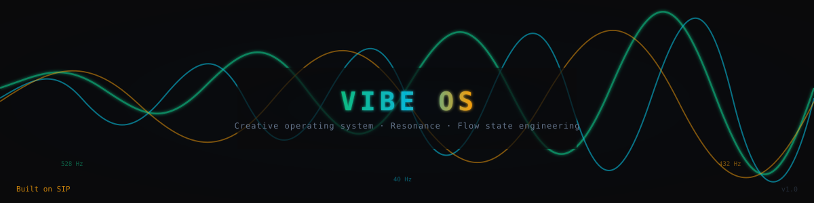

<p align="center">
  
</p>

# Vibe OS
## Research-Backed Music for State Change

Music prompts and tone tools built on published music-psychology research. Vibe OS combines:

- **Music Psychology Research** - Tempo, mode, timbre, and lyrics science
- **AI Music Generation** - Optimized prompts for Suno, Hailuo, Udio
- **Tones and binaural beats** - Binaural beats and solfeggio-frequency tones (the evidence is mixed; see the research notes)
- **Intelligent Mixing** - Research-backed audio layering

---

## Quick Start

```bash
# Clone the repo
git clone https://github.com/frankxai/vibe-os.git
cd vibe-os

# Generate a prompt for your desired state
python tools/vibe-prompt-generator.py --state confidence --with-lyrics

# List all available states
python tools/vibe-prompt-generator.py --list
```

---

## The Science

**[Read the Full Whitepaper →](docs/whitepaper-the-science-of-state-change.md)**

Vibe OS draws on published research from:
- **Psychomusicology** - How music affects mood and cognition
- **Music Therapy** - Music-therapy literature on mood and state change (nothing in this repo is clinical)
- **Sports Psychology** - Music for performance enhancement
- **Neuroscience** - Brain responses to musical elements

### Key Findings

| Element | Effect | Research |
|---------|--------|----------|
| **Tempo** | Faster tempo was rated as higher arousal | Nature Scientific Reports 2025 |
| **Mode** | Major tends to be rated more positive, minor more negative | PMC11220113 |
| **Lyrics** | One review reports that all 42 independent variables analysed aligned with lyric content | PsyPost summary |
| **Music + Exercise** | Meta-analysis of 139 studies; effect sizes, not percentage gains: performance g = 0.31, perceived exertion g = 0.22, affect g = 0.48 (see [the research notes](docs/music-psychology-research.md)) | Terry et al. 2020 |

---

## State Library

### Energy States
| State | BPM | Key | Use Case |
|-------|-----|-----|----------|
| `morning_energy` | 120 | G Major | Start day positive |
| `high_energy` | 150 | E Major | Maximum drive |
| `workout` | 145 | D Major | Exercise optimal |

### Focus States
| State | BPM | Key | Use Case |
|-------|-----|-----|----------|
| `deep_focus` | 90 | C Major | Study, work |
| `creative_flow` | 100 | A Major | Ideas, creation |

### Calm States
| State | BPM | Key | Use Case |
|-------|-----|-----|----------|
| `relaxation` | 70 | F Major | Stress relief |
| `meditation` | 60 | Mixed | Mindfulness |
| `sleep` | 50 | D Minor | Rest preparation |

### Emotional States
| State | BPM | Key | Use Case |
|-------|-----|-----|----------|
| `confidence` | 128 | D Major | Self-assurance |
| `gratitude` | 90 | G Major | Appreciation |
| `emotional_release` | 72 | A Minor | Processing |
| `joy` | 130 | D Major | Celebration |

### Goal States
| State | BPM | Key | Use Case |
|-------|-----|-----|----------|
| `manifestation` | 100 | E Major | Visualization |
| `courage` | 115 | D Major | Face fears |
| `healing` | 65 | F Major | Recovery |

---

## Tools

### vibe-prompt-generator.py

Generate AI music prompts optimized for your target state.

```bash
# Generate prompt for a state
python tools/vibe-prompt-generator.py --state meditation

# Include lyrics guidance
python tools/vibe-prompt-generator.py --state confidence --with-lyrics

# Output as JSON
python tools/vibe-prompt-generator.py --state focus --json

# List all states
python tools/vibe-prompt-generator.py --list
```

**Example Output:**
```
VIBE: CONFIDENCE BOOST

--- SUNO/HAILUO PROMPT ---
anthemic, 128 BPM, D Major, piano, brass, strings,
powerful and driving, energetic, no soft acoustic

--- LYRICS GUIDANCE ---
Lyrics themes: power, self-belief, rising
Core message: I walk with confidence
Tone: powerful, high energy

--- FREQUENCY PAIRING ---
18 Hz binaural (alertness)
```

### vibe-os-mixer.py

Combine AI-generated music with tones and binaural beats.

```bash
# Mix music with theta binaural
python tools/vibe-os-mixer.py --music track.mp3 --frequency theta

# Add subliminal 528 Hz to any song
python tools/vibe-os-mixer.py --music song.mp3 --hz 528 --level subliminal

# Get instrument recommendations
python tools/vibe-os-mixer.py --recommend alpha
```

### frequency-generator-pro.py

Generate pure Hz tones and binaural beats.

```bash
# Pure 528 Hz tone
python tools/frequency-generator-pro.py --freq 528 --duration 300

# Theta binaural beat
python tools/frequency-generator-pro.py --preset theta --duration 600
```

---

## Lyrics Psychology

Research shows lyrics have powerful psychological effects:

### Lyric Types and Effects

| Type | Effect | Example Theme |
|------|--------|---------------|
| **Affirmation** | +Self-esteem, +Optimism | "I am unstoppable" |
| **Empowerment** | +Agency, +Control | "I rise above" |
| **Gratitude** | +Wellbeing, +Positivity | "Blessed by this moment" |
| **Visualization** | +Goal clarity | "I see my victory" |
| **Release** | Catharsis, Processing | "Let it all go" |

### Writing Effective Lyrics

1. **First person present tense** - "I am" not "I will be"
2. **Specific and sensory** - Include visual/physical details
3. **Emotional arc** - Build toward resolution
4. **Prosocial content** - Increases empathy in listeners

---

## Frequency Pairing

Enhance music with brainwave entrainment:

| Brainwave | Frequency | State | Pair With |
|-----------|-----------|-------|----------|
| Delta | 2 Hz | Deep sleep | sleep, healing |
| Theta | 6 Hz | Meditation | meditation, creative_flow |
| Alpha | 10 Hz | Calm focus | deep_focus, relaxation |
| Beta | 18 Hz | Alertness | confidence, workout |
| Gamma | 40 Hz | Peak cognition | high_energy |

---

## The ISO Principle

For state transitions, start with music matching current state, then gradually shift:

```
Anxious → Calm:
  110 BPM, A Minor → 90 BPM, D Minor → 75 BPM, G Major → 65 BPM, F Major
```

This applies the iso principle from music therapy. This repo does not test it.

---

## Claude Code Skills

This repo includes Claude Code skills for automatic prompt generation:

```
skills/
├── vibe-os-master.md      # Complete state change system
├── suno-ai-mastery.md     # Suno-specific techniques
└── suno-prompt-architect.md # Advanced prompt engineering
```

Copy to `~/.claude/skills/` to enable in Claude Code.

---

## Research Citations

### Primary Sources

1. **PMC8167645** - Ballmann (2021), music preference and exercise performance (review)
2. **PMC11220113** - Musical mode and emotions
3. **PMC2683716** - Timbre affects emotion perception
4. **Frontiers Psychology 2025** - Music emotion regulation review
5. **Nature Scientific Reports 2025** - Tempo modulates emotions
6. **PsyPost 2024** - Lyrics psychological impact meta-analysis
7. **Terry et al. 2020** - Effects of music in exercise and sport: a meta-analytic review, Psychological Bulletin 146(2), [doi:10.1037/bul0000216](https://doi.org/10.1037/bul0000216)

### Full Documentation

- [Music Psychology Research](docs/music-psychology-research.md)
- [Frequency Healing Research](docs/frequency-healing-research.md)
- [Production System Guide](docs/vibe-os-production-system.md)

---

## Requirements

```bash
pip install numpy
```

Optional: FFmpeg for MP3 support

---

## Examples

### Morning Routine
```bash
python tools/vibe-prompt-generator.py --state morning_energy --with-lyrics
# Use output in Suno/Hailuo, then:
python tools/vibe-os-mixer.py --music morning.mp3 --frequency alpha
```

### Workout Session
```bash
python tools/vibe-prompt-generator.py --state workout --with-lyrics
# Generate in Suno at 145 BPM
```

### Evening Wind-Down
```bash
python tools/vibe-prompt-generator.py --state relaxation
python tools/frequency-generator-pro.py --preset alpha --duration 600
python tools/vibe-os-mixer.py --music relax.mp3 --frequency alpha --level subtle
```

---

## License

Licensed under FSL-1.1-ALv2 (each version converts to Apache-2.0 two years after publication). See [LICENSE](LICENSE) and [LICENSING.md](LICENSING.md); earlier releases published under MIT remain under MIT.

---

## Contributing

PRs welcome! Especially:
- Additional research citations
- New state presets
- Improved prompt templates
- Bug fixes

---

*Part of the FrankX Superintelligent Agent System*

**"Music is a legal performance-enhancing drug."** - Costas Karageorghis
